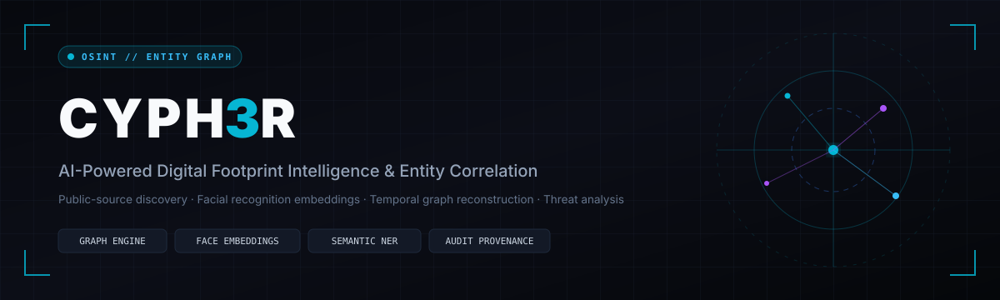

<div align="center">



<br/>

[](https://python.org)
[](https://fastapi.tiangolo.com)
[](https://pytorch.org)
[](https://opencv.org)
[](https://networkx.org)
[](LICENSE)
[](docs/SECURITY.md)

<p align="center">
  <b>Decode the Public Web at National Scale · AI-Powered Digital Footprint & Entity Correlation Engine</b>
</p>

</div>

---

## 📌 Executive Overview

**CYPH3R** is an open-source investigative intelligence platform engineered for public-source discovery, entity correlation, and deep operational analysis. Built for cybersecurity teams, forensic researchers, and threat analysts, CYPH3R fuses **computer vision**, **semantic Named Entity Recognition (NER)**, and **temporal graph analytics** to reconstruct digital footprints and surface covert relationships with verifiable provenance.

---

## ⚙️ Core Architecture


---

## 🚀 Key Capabilities

### 1. 🔍 Automated Entity Extraction & Correlation
- **Multimodal Ingestion:** Extracts structured entities across unstructured text, PDFs, social archives, and network dumps.
- **Cross-Source Disambiguation:** Resolves aliases, cryptographic hashes, email fingerprints, and handle re-use across disparate platforms.
- **Confidence Scoring:** Every relationship edge carries an evidentiary weight and source attribution timestamp.

### 2. 👁️ Computer Vision & Biometric Embeddings
- **Face Detection & Alignment:** Real-time multi-angle face detection powered by MTCNN and RetinaFace.
- **Vector Embedding Search:** Generates 512-dimensional facial feature vectors indexed in FAISS for sub-millisecond similarity scoring.
- **Deepfake & Tampering Heuristics:** Detects frequency-domain compression artifacts and duplicate media hashes.

### 3. 🕸️ Temporal Graph Analytics
- **Relational Graph Construction:** Builds multi-layered directional graphs mapping `Person -> Organization -> Domain -> Infrastructure`.
- **Centrality & Clustering:** Computes PageRank, Betweenness Centrality, and Louvain community clusters to isolate key threat actors.
- **Timeline Reconstruction:** Chronologically orders event interactions to uncover historical operational patterns.

---

## ⚡ Quickstart

### 1. Clone & Install Environment
```bash
git clone https://github.com/DeepxkJadhav/CYPH3R.git
cd CYPH3R

# Create virtual environment
python -m venv .venv
source .venv/bin/activate  # On Windows: .venv\Scripts\activate

# Install dependencies
pip install -r requirements.txt
```

### 2. Configure Environment
```bash
cp .env.example .env
# Edit .env with your optional storage paths and API preferences
```

### 3. Launch Ingestion & API Server
```bash
# Start FastAPI backend
uvicorn app.main:app --host 0.0.0.0 --port 8000 --reload
```

Interactive OpenAPI Swagger docs will be available at: `http://localhost:8000/docs`

---

## 🛠️ Tech Stack

| Category | Technologies |
|---|---|
| **Core Framework** | Python 3.10+, FastAPI, Pydantic v2, Uvicorn |
| **Vision & Biometrics** | PyTorch, OpenCV, InsightFace, FaceNet, FAISS |
| **NLP & Semantics** | spaCy, Sentence-Transformers, HuggingFace |
| **Graph & Storage** | NetworkX, SQLite WAL, SQLite-Vec / FAISS |
| **Deployment** | Docker, Docker Compose, GitHub Actions CI |

---

## 🛡️ Responsible Use & Ethical Guidelines

CYPH3R is designed exclusively for:
1. Authorized cybersecurity investigations and defensive security audits.
2. Law enforcement, academic, and journalistic open-source research (OSINT).
3. Personal privacy risk assessments and digital footprint exposure auditing.

Users are strictly responsible for complying with all applicable privacy regulations (including GDPR, CCPA, and national data governance laws). Commercial distribution or malicious surveillance is strictly prohibited under the project license.

---

## 📄 License

Distributed under the **GNU Affero General Public License v3.0 (AGPL-3.0)**.  
Maintained with precision by **Deepak Jadhav ([@DeepxkJadhav](https://github.com/DeepxkJadhav))**.
